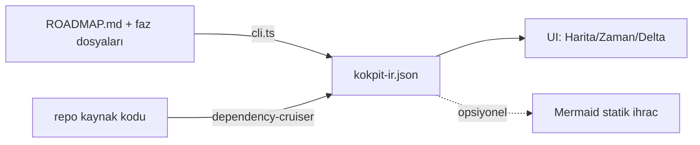

# KokpitPro — Arayüz Sözleşmesi (UI-SPEC)

> **Durum:** 🟡 TASLAK v0.2.1 — **Patron onayı bekliyor** (görsel dil §3 +
> vibecoding-dostu sunum). Onay verilirse BAĞLAYICI olur.
> **Canlı önizleme:** `arayuz-onizleme.html` — tarayıcıda çift tıkla açın;
> TR/EN ve açık/koyu düğmeleri çalışır.

## §0 · Nasıl Okunur — vibecoding dostu kılavuz

Bu belge **kodsuz okunabilir** olacak şekilde yazılır:

1. **Her teknik adın yanında anlaşılır Türkçesi parantez içinde durur:**
   *Zaman Çizelgesi (timeline)* = "fazların üst üste dizildiği liste ekranı".
2. **Etiketler doğrudan Türkçedir** — ekranda görünecek olan budur. İngilizce
   karşılıklar yalnız sağda küçük harfle, EN moda geçince ekranda görünecek
   metin olarak verilir: *Kodlandı (done → Done)*.
3. **Renk/şekil örnekleri emoji ile gösterilir** (🟢🟡⚪); ürün içinde aynı
   anlam profesyonel ikonlarla çizilir.
4. Karar verilmesi gereken yerler ⚖️, bilinçli yasaklar 🚫 ile işaretlidir.
5. Uygulama dosya yolları (`kokpit/parser/…`) geliştirici notudur — okumak
   için gerekmez.

**Mini sözlük:** *IR* = ara-veri dosyası (parser'ın çıkardıği kokpit-ir.json)
· *düğüm (node)* = haritadaki her kutu · *kenar (edge)* = kutuları bağlayan
çizgi · *çekmece (drawer)* = sağdan açılan detay paneli · *belirteç (token)* =
rengin tek kayıt yerindeki adı.


---

## §1 · Ürün Tanımı ve Ekran Envanteri

KokpitPro tek sayfalık yerel bir uygulamadır (tarayıcıda açılır, veriyi
`kokpit-ir.json` dosyasından okur). **Üç görünüm + bir panel:**

| Görünüm | Kod adı | Ne gösterir | Hangi dilimde doğar |
|---|---|---|---|
| **Harita** | `map` | Repoyu düğüm/kenar grafiği olarak; düğümler faz durumuna göre boyalı | Dilim 2 |
| **Zaman Çizgisi** | `timeline` | Fazlar yatay şeritler; maddeler durum rozetleriyle | Dilim 2 (basit sürüm) |
| **Delta Ön-görünümü** | `delta` | Seçilen plan-adımı kodlanınca haritada ne değişecek | Dilim 3 |
| Remap Paneli | `remap` | Yeniden düzenleme önerileri (her görünümden açılır çekmece) | Dilim 4 |

## §2 · Ekran Anatomisi (Harita görünümü — ana yüzey)

```
┌────────────────────────────────────────────────────────────────────┐
│ ÜST ŞERİT: [KokpitPro] [repo seçici ▾]        [TR|EN] [🎨 tema]    │ ← 48px
├──────────────┬──────────────────────────────────┬──────────────────┤
│ SOL PANEL    │ MERKEZ: HARİTA (React Flow)      │ SAĞ ÇEKMECE       │
│ 240px        │                                  │ 320px (kapatılabilir)│
│ ┌──────────┐ │   ┌─────────┐    ┌─────────┐     │ Seçili düğüm:     │
│ │Faz ağacı │ │   │ handlers│───▶│services │     │ · yol + satır     │
│ │ P0 ✅(9) │ │   └────┬────┘    └────┬────┘     │ · durum + gerekçe │
│ │ P1 🔶(7) │ │        │              │          │ · ilgili faz madde│
│ │ P2 🔶(6) │ │   ┌────▼────┐    ┌────▼────┐     │ · ilgili testler  │
│ │ ...      │ │   │schema.ts│    │ ai.ts   │     │ [Kaynağı aç ↗]    │
│ │          │ │   └─────────┘    └─────────┘     │                   │
│ │ LEJANT   │ │  alt-sol köşe: zoom ± / sığdır   │                   │
│ └──────────┘ │                                  │                   │
├──────────────┴──────────────────────────────────┴──────────────────┤
│ ALT ŞERİT: [Harita][Zaman Çizgisi][Delta] sekmeleri + durum çubuğu  │ ← 32px
└────────────────────────────────────────────────────────────────────┘
```

### Bölge kuralları

| # | Kural |
|---|---|
| A1 | Sol panel faz ağacı: her satır = grup başlığı + sayaç rozeti `(yeşil/toplam)`; tıklanınca o faza ait düğümler haritada **vurgulanır**, diğerleri soluklaşır |
| A2 | Merkez harita: düğüm = dizin/dosya kümesi; kenar = import ilişkisi; **pan/zoom** fare ile; `Sığdır` düğmesi her zaman görünür |
| A3 | Sağ çekmece: hiçbir seçim yokken kapanır; düğüm/faz/madde seçimi açar; `Esc` kapatır |
| A4 | Alt şerit sekmeleri görünümler arası geçiştir; aktif sekme altı çizili |
| A5 | Üst şerit repo seçici: son açılan `kokpit-ir.json` yollarını hatırlar (localStorage) |

## §3 · Görsel Dil v2 — "Trafik Lambası" Sistemi

> Tasarım hedefi: **ilk bakışta anla, ikinci bakışta güven.** Kullanıcıya
> sorulan tek soru: *"Bu iş bitti mi, sürüyor mu, bekliyor mu?"* — cevap her
> yerde aynı üç şekil + aynı üç renktir.

### §3.1 Üç Ana Durum (dünyaca bilinen trafik metaforu)

| | Şekil | Renk | Token | Etiket TR / EN | Anlam |
|---|---|---|---|---|---|
| 🟢 | **DOLU** daire/kare | Zümrüt `#10b981` (zemin `#ecfdf5`) | `--st-done` | Kodlandı / Done | İş bitti, kanıtı var |
| 🟡 | **KESİKLİ kenarlıklı**, amber dolgu | Amber `#f59e0b` (zemin `#fffbeb`) | `--st-partial` | Sürüyor / In progress | Yarında — hareket var |
| ⚪ | **BOŞ** kontur | Gri `#cbd5e1`, metin `#64748b` | `--st-open` | Planlandı / Planned | Sırada — henüz yok |

**Neden bu üçlü:** herkesin okuldan beri bildiği kırmızı-sarı-yeşil dizilimi.
Kırmızıyı bilinçli KULLANMIYORUZ — kırmızı "hata" demektir, "planlandı" hata
değildir. Hata/uyarı ayrı bir dil (aşağıda).

### §3.2 Örnek Kartlar (bileşenler tam böyle çizilir)

**Harita düğümü — üç durum yan yana:**

```
  ╭──────────────╮   ┌╌╌╌╌╌╌╌╌╌╌╌╌┐   ╭ ─ ─ ─ ─ ─ ─ ╮
  │ ██ services  │   │ ⋯ handlers │   │   ai.ts     │
  │ 🟢 Kodlandı  │   │ 🟡 Sürüyor │   │ ⚪ Planlandı │
  ╰──────────────╯   └╌╌╌╌╌╌╌╌╌╌╌╌┘   ╰ ─ ─ ─ ─ ─ ─ ╯
     DOLU zemin         kesikli çerçeve      boş kontur
```

**Faz satırı (sol panel):**

```
 P1 · Kanıt Altyapısı            ████████░░░░  4/7
   ├─ 🟢 Kanonik eser modeli
   ├─ 🟡 Çok kaynaklı bağlayıcılar
   └─ ⚪ Kartopu (snowballing)
```

**Zaman çizelgesi çipi:**

```
 [🟢 #1 Konsensüs körlüğü]  [🟡 Bağlayıcılar]  [⚪ Kartopu]
```

**Lejant kartı (harita sol-alt köşe, kalıcı):**

```
┌ LEJANT ──────────────────┐
│ ● Kodlandı    ● Sürüyor  │
│ ○ Planlandı   ◌ GO bekliyor│
│ ⬚ Eklenecek (delta)      │
└──────────────────────────┘
```

### §3.3 İkincil Sinyaller (ana üçlüyü kirletmeden)

| Sinyal | Görsel | Nerede | Neden ayrı dil |
|---|---|---|---|
| **GO bekliyor** | 🔵 mavi **dış kontur halkası** (`#0ea5e9`, 2px) — iç renk ana durumu göstermeye devam eder | kodu bitmiş ama kapıda bekleyen | "hazır ama kapalı" = geçici durum |
| **Delta: eklenecek** | ⬚ kesikli hayalet düğüm, yeşil `%40 opak` | Delta görünümü | henüz yok — gelecek |
| **Delta: değişecek** | mevcut düğümde amber köşe-noktası • | Delta görünümü | dokunulacak |
| **Bayat veri (>7g)** | alt şeritte 🕐 rozet | global | haritayı boyamaz |
| **Hata / engel** | kırmızı YALNIZ burada: `#dc2626` satır-içi mesaj + 🔴 ikon | hata kartları | kırmızının değeri nadirliğidir |

### §3.4 Kural Seti (kod yazan herkes için)

1. Bileşende hex YASAK — yalnız token (`--st-*`); koyu tema karşılıkları
   belirteçte yaşar.
2. Her renkli öğenin **metin etiketi veya ikonu** vardır; renk tek başına
   bilgi taşımaz (renk-körü dostu).
3. Bir ekranda aynı anda en fazla **3 farklı dolgu rengi** görünür; fazlası
   çekmeceye iner.
4. Emoji (🟢🟡⚪) yalnız belge/CLI çıktısında kullanılır; ürün içinde ikon
   kütüphanesi (lucide) ile aynı anlam çizilir.

### §3.5 Karşılaştırma — eski vs yeni

| Eski (v0.1) | Yeni (v0.2) |
|---|---|
| 7 durum × hex tablosu | 3 ana durum + 5 ikincil sinyal |
| `go-waiting` ayrı renk → 4 renk karışırdı | mavi HALKA; iç renk korunur |
| delta renkleri ana sözlükte | delta kendi görünümünün dili |
| kırmızı tanımsız (yanlışlıkla kullanılabilirdi) | kırmızı yalnız hataya rezerve |

## §4 · Veri Akışı (tek yön, döngüsüz)



- **Kokpit-IR v1 şeması** (`schema.ts` genişletmesi): `nodes[{id,path,status,phaseRefs[]}]`,
  `edges`, `phases[PhaseGroup...]`, `meta{generatedAt,sources[]}`.
- UI **hesaplama yapmaz**: yalnız IR'yi okur ve boyar (Aptal-Frontend mirası).
- Yenileme = CLI'yı yeniden koşturmak; UI'da "veri taze" mi? göstergesi
  (`generatedAt` farkından okunur).

## §5 · Görünüm Detayları

### §5.1 Zaman Çizgisi
Fazlar üstten alta; her faz satırında madde çipleri: `[●] #1 Konsensüs…`
(● renk= durum). Madde çipine tıkla → sağ çekmecede tam metin + satır
numarası + "haritada göster" (ilişkili düğüm varsa vurgular).

### §5.2 Delta Ön-görünümü (Dilim 3)
Girdi: plan durumundaki bir madde seçilir. Çıktı kartında:
1. Etkilenecek düğümler (kesikli yeşil/amber harita vurgusu eş zamanlı)
2. Etkilenecek test dosyaları (yol eşleşmesinden)
3. Kaynak: maddenin ROADMAP satır alıntısı
Veri yetersizse kart **"bu madde için yol eşlemesi yok"** der — tahmin üretmez.

### §5.3 Remap Paneli (Dilim 4)
Öneri kartı: `[öneri] Neden: X dosyası 3 farklı katmandan import ediliyor →
öneri: services/ altına taşı`. Uygula butonu YOKTUR (v1) — yalnız kopyalanabilir
metin; uygulama insan kararıdır.

### §5.4 Boş/Hata durumları (hepsi D2#3'e tabi)
| Durum | Ekran |
|---|---|
| IR yok | "Başlamak için: npm run kokpit -- --roadmap …" komut kartı |
| Parser 0 madde | "Faz belgesi bulunamadı" + girdi yolu gösterilir |
| Import-grafı boş | Harita yerine düz liste görünümüne otomatik düşer |
| Bayat veri (>7 gün) | Alt şeritte amber "veri bayat" rozeti |

## §6 · Teknoloji ve Dosya Yapısı (kesinleştirme — onay istenir)

- **Stack:** Vite + React 19 + TypeScript + Tailwind v4 + **React Flow** +
  `mermaid` (statik ihrac) + `zustand` (görünüm durumu). Sunucusuz — tamamen
  tarayıcı-içi.
- **Yapı:**
  ```
  app/                    ← Vite kökü (index.html, main.tsx)
  src/
    features/map/         ← Harita görünümü + React Flow wrapper
    features/timeline/    ← Zaman çizelgesi
    features/delta/       ← Delta ön-görünümü
    lib/ir/               ← Kokpit-IR tipleri + loader
    lib/diagram/          ← GitDiagram'dan taşınan saf motor (bkz. adaptasyon tablosu)
    i18n/                 ← labels + locale dosyaları
  ```
- Motor taşımaları (XS-S maliyetli): graph-schema, validate/compile,
  mermaid-sanitize seti, export — adaptasyon tablosundaki gibi.

## §7 · Kabul Kriterleri (görünüm başına)

| Görünüm | Kabul |
|---|---|
| Harita | MethodLogos reposu IR'iyle ≥30 düğüm akıcı gezilir; her düğümden kaynağa tıklama çalışır; lejant tüm durumları gösterir |
| Timeline | 62 maddenin tamamı doğru durum rozetiyle listelenir |
| Delta | Plan-adımı seçince ≥1 düğüm vurgusu + test listesi; verisiz maddede dürüst mesaj |
| i18n | TR↔EN geçişte hiçbir ekranda karma dil kalmaz; parity testi yeşil |

## §8 · Bilinçli Sınırlar (v1'de YAPILMAZ)

Çalışma-zamanı telemetrisi · çok-kullanıcı/sunucu · düzenleme (harita elle
düzenlenemez) · AI ile otomatik gruplama (gitdiagram motoru opsiyonel kalır) ·
mobil-özel tasarım (duyarlı ama masaüstü öncelik).

---
**Onay bloğu:** Patron onayı: ⬜ (onaylanırsa durum BAĞLAYICI'ya çevrilir ve
Dilim 2 bu sözleşmeye göre kodlanır.)
