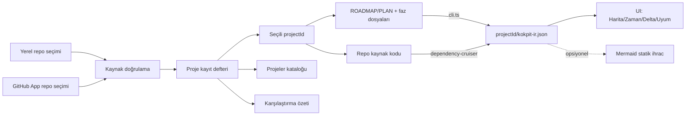

# KokpitPro — Arayüz Sözleşmesi (UI-SPEC)

> **Durum:** 🟢 **BAĞLAYICI v1.0** (Patron onayı 2026-08-24 ve mimari harita
> genişletme onayı 2026-08-27 — onay bloğu §son imzalı). **Uygulama durumu
> sözleşmeden ayrıdır:** §12 proje yaşam döngüsü büyük ölçüde bağlıdır; Harita
> güncel indeks makbuzunda ölçülmüş repo verisini, ölçüm yoksa açıkça etiketli
> örnek durumu gösterir; Delta (§5.2) Dilim 3 ile gerçek modda açıldı — yalnız
> seçili madde için ölçülmüş kanıt; kanıt yoksa ölçülemiyor. §10 Uyum motoru
> Dilim 5 kapsamında hâlâ açıktır. Remap v2 backlog'tadır.
> **Kapsam:** proje kataloğu, kalıcı yerel/GitHub bağlantı servisi, proje
> değiştirici, veri izolasyonu, portföy karşılaştırması, tam-yükseklik kabuk,
> Harita/Zaman/Delta/**Uyum** yüzeyleri.
> **Canlı önizleme:** `arayuz-onizleme.html` — Projeler / Çalışma alanı /
> Karşılaştır üst düzey akışları; dört adımlı repo bağlama; proje seçimi;
> canlı `PLAN.md` faz/alt-madde incelemesi; TR/EN, açık-koyu tema, klavye
> komutları ve duyarlı yerleşim. Katalog kayıtları `.kokpit/data/projects.json`
> içinde kalıcıdır; kaynak/dal/commit/plan makbuzu gerçek yerel Git veya GitHub
> Contents doğrulamasından gelir.
> Üst sözleşmeler: `DESIGN.md` D1–D5.

## §0 · Nasıl Okunur — vibecoding dostu kılavuz

Bu belge **kodsuz okunabilir** olacak şekilde yazılır:

1. **Her teknik adın yanında anlaşılır Türkçesi parantez içinde durur:**
   *Zaman Çizelgesi (timeline)* = "fazların üst üste dizildiği liste ekranı".
2. **Etiketler doğrudan Türkçedir** — ekranda görünecek olan budur. İngilizce
   karşılıklar yalnız sağda küçük harfle, EN moda geçince ekranda görünecek
   metin olarak verilir: *Kodlandı (done → Done)*.
3. **Renk/şekil örnekleri emoji ile gösterilir** (🟢🟡⚪); ürün içinde aynı
   anlam profesyonel ikonlarla çizilir.
4. Karar verilmesi gereken yerler ⚖️, bilinçli yasaklar 🚫 ile işaretlidir.
5. Uygulama dosya yolları (`kokpit/parser/…`) geliştirici notudur — okumak
   için gerekmez.

**Mini sözlük:** *IR* = ara-veri dosyası (parser'ın çıkardıği kokpit-ir.json)
· *düğüm (node)* = haritadaki her kutu · *kenar (edge)* = kutuları bağlayan
çizgi · *çekmece (drawer)* = sağdan açılan detay paneli · *belirteç (token)* =
rengin tek kayıt yerindeki adı.

### §0.1 Terim Sözlüğü — kanonik adlar (çapraz denetim kararı, 2026-08-24)

| Kanonik ad (kod ne diyorsa o) | Yasak/dağınık kullanımlar | Sahip dosya |
|---|---|---|
| **RoadmapScan + PhaseFileScan** | ~~PhaseSlice[]~~ · ~~"Kokpit-IR v0"~~ | `kokpit/parser/schema.ts` |
| **Kokpit-IR v0.2** (sync/violations/conflicts) | — | Dilim 5'te gelir |
| **Dilim 0–5** (faz numaraları) | ~~D0/D1… önekleri~~ — DESIGN D1–D5 ile karışır | PLAN.md |
| **D1–D5** | yalnız DESIGN karar ID'sidir, faz DEĞİLDİR | DESIGN.md |
| **--st-done/partial/open/go** | ~~--done/--progress/--planned~~ | UI-SPEC §3.1 |


---

## §1 · Ürün Tanımı ve Ekran Envanteri

KokpitPro çok sayıda yerel ve GitHub reposunu kaydedebilen, fakat ayrıntılı
incelemeyi **tek etkin proje bağlamında** yapan proje-kataloğu tabanlı yerel bir
uygulamadır. Ürün üç üst düzey katman ve etkin proje içinde dört analiz görünümü
sağlar:

| Üst düzey katman | Kod adı | Ne gösterir |
|---|---|---|
| **Projeler** | `projects` | Kayıtlı repolar, bağlantı türü, dal, plan kaynağı, son indeksleme ve bağlantı sorunları |
| **Çalışma alanı** | `workspace` | Yalnız etkin projenin faz, kod, delta, uyum ve kanıt verileri |
| **Karşılaştır** | `compare` | Seçilmiş projelerin üst düzey özetini; dosya/faz kayıtlarını birbirine karıştırmadan |

Etkin proje çalışma alanında **dört ana görünüm + bağlamsal denetçi** bulunur:

| Görünüm | Kod adı | Ne gösterir | Hangi dilimde doğar |
|---|---|---|---|
| **Harita** | `map` | Repoyu düğüm/kenar grafiği olarak; düğümler faz durumuna göre boyalı | Dilim 2 |
| **Zaman Çizgisi** | `timeline` | Fazlar yatay şeritler; maddeler durum rozetleriyle | Dilim 2 (basit sürüm) |
| **Delta Ön-görünümü** | `delta` | Seçilen plan-adımı kodlanınca haritada ne değişecek | Dilim 3 |
| **Uyum** | `compliance` | Defter senkronu, kural ihlali ve karar bütünlüğü; özetten kanıta iner | **Dilim 5** (bu PLAN) |
| Bağlamsal Denetçi | `inspector` | Seçili faz için alt maddeler, durum özeti, kabul ve beklenen çıktı; düğüm/madde/ihlal için kaynak ve kanıt | Her görünüm |
| Remap Paneli | `remap` | Yeniden düzenleme önerileri; denetçi içinde ayrı mod | v2 backlog (dilimsiz) |

Uygulama birden fazla projeyi hatırlar. Ana çalışma alanında aynı anda tek
proje etkindir. İlişkili birden fazla repo ancak açıkça oluşturulmuş bir
`workspaceGroup` içinde birlikte taranabilir; kök repo adı her dosya, arama
sonucu ve kanıt yolunda görünür. Portföy karşılaştırması analiz verilerini tek
bir zaman çizgisine veya başarı yüzdesine birleştirmez.

## §2 · Ekran Anatomisi — ürün-kalitesi kabuk

Kokpit iki soruyu sırayla sorar: **"Hangi projedeyim?"** ve **"Şu anda
ilgilenmem gereken şey ne, kanıtı nerede?"** Yerleşim bu sorulara genelden
özele dört seviyede cevap verir:

1. **Uygulama şeridi:** etkin proje seçici, repo/dal/kaynak bağlamı,
   arama/komut (`Ctrl/Cmd+K`), dil, tema ve veri modu.
2. **Ürün bölümü:** Projeler / Çalışma alanı / Karşılaştır. Bölüm değişse de
   etkin proje bağlamı ve bağlantı durumu kaybolmaz.
3. **Görünüm + sinyal şeridi:** dört görünüm sekmesi; yalnız dikkat isteyen
   birincil sinyal ve en fazla üç kompakt ikincil sayaç.
4. **Çalışma alanı:** faz filtresi + ana yüzey + bağlamsal denetçi.

```text
┌ UYGULAMA ŞERİDİ ────────────────────────────────────────────────────┐
│ [KokpitPro ▾ · yerel/master]    [Ara… ⌘K] [CANLI PLAN] [TR] [Tema]│
├ ÜRÜN BÖLÜMÜ ───────────────────────────────────────────────────────┤
│ Projeler     Çalışma alanı     Karşılaştır     Son indeks: 4 dk   │
├ GÖRÜNÜM ────────────────────────────────────────────────────────────┤
│ Harita  Zaman  Delta  Uyum       PLAN.md: 7 faz · 27 madde · 12 tamam│
├ SİNYAL ─────────────────────────────────────────────────────────────┤
│ Dikkat: plan canlı; harita örnek    Defter —  İhlal —  Çelişki —   │
├──────────────┬──────────────────────────────────┬───────────────────┤
│ FAZ FİLTRESİ │ ANA YÜZEY                         │ DENETÇİ           │
│ 15rem        │ Harita / liste / dürüst boş durum │ 21rem / kapanır   │
│              │                                  │ kaynak + kanıt    │
└──────────────┴──────────────────────────────────┴───────────────────┘
```

Bu yapı dört eşit "dashboard kartı"na dayanmaz. Sinyaller bir özet şeridinde,
asıl iş ise tek baskın yüzeyde yaşar. Böylece kullanıcı nereye bakacağını
seçmek zorunda kalmaz.

### Bölge kuralları

| # | Kural |
|---|---|
| A1 | Faz planları bir `nav` bölgesidir; her satır gerçek `button` olur, seçili durum `aria-pressed` ile bildirilir; seçim alt madde ve kabul detayını denetçide açar |
| A2 | Merkez harita: düğüm = dizin/dosya kümesi; kenar = import ilişkisi; düğümler klavye ile seçilir; zoom ve `Sığdır` gerçekten çalışır |
| A3 | Denetçi masaüstünde bağlamsal sütun, dar ekranda sağdan açılan paneldir; `Esc` kapatır, odak açan kontrole döner |
| A4 | Görünüm sekmeleri üst şerittedir; `tablist/tab/tabpanel`, `aria-selected` ve ok tuşu davranışı eksiksizdir |
| A5 | Repo seçici son açılan `kokpit-ir.json` yollarını hatırlar; veri kaynağı/modu her an görünürdür |
| A6 | Arama `/` veya `Ctrl/Cmd+K` ile açılır; düğüm, faz ve maddeyi aynı yüzeyden bulur |
| A7 | Çalışmayan aksiyon çizilmez. Demo önizlemede gerçek kaynak yolu yoksa düğme devre dışı ve nedeni görünürdür |
| A8 | Proje seçimi atomiktir: üst şerit, fazlar, harita, zaman, delta, uyum ve denetçi aynı `projectId` değişimini tüketir; eski projenin seçimi/kanıtı temizlenir |
| A9 | Projeler bölümü çoklu repo kataloğudur; Çalışma alanı tek etkin repo; Karşılaştır yalnız açıkça seçilen projelerin ayrık özetidir |
| A10 | Yerel/GitHub bağlantı akışı Kaynak → Doğrula → İndeksle → Hazır adımlarını atlamaz; hangi adımın tamamlandığı ve neyin beklendiği görünürdür |

## §3 · Görsel Dil v3 — sakin komuta yüzeyi

> Tasarım hedefi: **ilk bakışta anla, ikinci bakışta güven.** Kullanıcıya
> sorulan tek soru: *"Bu iş bitti mi, sürüyor mu, bekliyor mu?"* — cevap her
> yerde aynı üç şekil + aynı üç renktir.

### §3.0 Tasarım temeli

- **Tipografi:** `Segoe UI Variable` / `Aptos` / sistem sans; başlıkta Display
  varyantı, sayılarda tabular figures, kod ve yol için monospace. Başlıklar
  cümle biçimindedir; arayüz boyunca büyük harfli etiket yağmuru yoktur.
- **Yüzey:** koyu temada mürekkep laciverti (`#0b0e14`), açık temada soğuk
  beyaz (`#f4f6f8`). Tek marka vurgusu buz mavisidir. Yeşil/amber/kırmızı
  yalnız semantik durum içindir; marka rengi gibi kullanılmaz.
- **Derinlik:** dış kabuk ve denetçi ayrımı çizgi/boşlukla kurulur. Her içerik
  ayrı beyaz kart olmaz; gölge yalnız kayan denetçi ve komut paletinde vardır.
- **Yoğunluk:** ana yüzey ferah, listeler sıkıdır. Bir satır bir karar veya
  kanıt taşır; yardımcı metin en fazla iki satırdır.
- **İkon:** ürün içinde emoji yoktur. Aynı 1.75px çizgi kalınlığındaki SVG ikon
  seti kullanılır; her ikonun erişilebilir adı ya da görünür metin etiketi vardır.
- **Hareket:** 160–220ms, yalnız `transform` ve `opacity`; `prefers-reduced-motion`
  altında kapanır.

### §3.1 Üç Ana Durum (dünyaca bilinen trafik metaforu)

| | Şekil | Renk | Token | Etiket TR / EN | Anlam |
|---|---|---|---|---|---|
| 🟢 | **DOLU** daire/kare | Zümrüt `#10b981` (zemin `#ecfdf5`) | `--st-done` | Kodlandı / Done | İş bitti, kanıtı var |
| 🟡 | **KESİKLİ kenarlıklı**, amber dolgu | Amber `#f59e0b` (zemin `#fffbeb`) | `--st-partial` | Sürüyor / In progress | Yarında — hareket var |
| ⚪ | **BOŞ** kontur | Gri `#cbd5e1`, metin `#64748b` | `--st-open` | Planlandı / Planned | Sırada — henüz yok |

**Neden bu üçlü:** herkesin okuldan beri bildiği kırmızı-sarı-yeşil dizilimi.
Kırmızıyı bilinçli KULLANMIYORUZ — kırmızı "hata" demektir, "planlandı" hata
değildir. Hata/uyarı ayrı bir dil (aşağıda).

### §3.2 Örnek Kartlar (bileşenler tam böyle çizilir)

**Harita düğümü — üç durum yan yana:**

```
  ╭──────────────╮   ┌╌╌╌╌╌╌╌╌╌╌╌╌┐   ╭ ─ ─ ─ ─ ─ ─ ╮
  │ ██ services  │   │ ⋯ handlers │   │   ai.ts     │
  │ 🟢 Kodlandı  │   │ 🟡 Sürüyor │   │ ⚪ Planlandı │
  ╰──────────────╯   └╌╌╌╌╌╌╌╌╌╌╌╌┘   ╰ ─ ─ ─ ─ ─ ─ ╯
     DOLU zemin         kesikli çerçeve      boş kontur
```

**Faz satırı (sol panel):**

```
 P1 · Kanıt Altyapısı            ████████░░░░  4/7
   ├─ 🟢 Kanonik eser modeli
   ├─ 🟡 Çok kaynaklı bağlayıcılar
   └─ ⚪ Kartopu (snowballing)
```

**Zaman çizelgesi çipi:**

```
 [🟢 #1 Konsensüs körlüğü]  [🟡 Bağlayıcılar]  [⚪ Kartopu]
```

**Lejant kartı (harita sol-alt köşe, kalıcı):**

```
┌ LEJANT ──────────────────┐
│ ● Kodlandı    ● Sürüyor  │
│ ○ Planlandı   ◌ GO bekliyor│
│ ⬚ Eklenecek (delta)      │
└──────────────────────────┘
```

### §3.3 İkincil Sinyaller (ana üçlüyü kirletmeden)

| Sinyal | Görsel | Nerede | Neden ayrı dil |
|---|---|---|---|
| **GO bekliyor** | 🔵 mavi **dış kontur halkası** (`#0ea5e9`, 2px) — iç renk ana durumu göstermeye devam eder | kodu bitmiş ama kapıda bekleyen | "hazır ama kapalı" = geçici durum |
| **Delta: eklenecek** | ⬚ kesikli hayalet düğüm, yeşil `%40 opak` | Delta görünümü | henüz yok — gelecek |
| **Delta: değişecek** | mevcut düğümde amber köşe-noktası • | Delta görünümü | dokunulacak |
| **Bayat veri (>7g)** | alt şeritte 🕐 rozet | global | haritayı boyamaz |
| **Hata / engel** | kırmızı YALNIZ burada: `#dc2626` satır-içi mesaj + 🔴 ikon | hata kartları | kırmızının değeri nadirliğidir |

### §3.4 Kural Seti (kod yazan herkes için)

1. Bileşende hex YASAK — yalnız token (`--st-*`); koyu tema karşılıkları
   belirteçte yaşar.
2. Her renkli öğenin **metin etiketi veya ikonu** vardır; renk tek başına
   bilgi taşımaz (renk-körü dostu).
3. Bir ekranda aynı anda en fazla **3 farklı dolgu rengi** görünür; fazlası
   çekmeceye iner.
4. Emoji (🟢🟡⚪) yalnız belge/CLI çıktısında kullanılır; ürün içinde tek bir
   tutarlı SVG ikon seti ve CSS durum işaretleri kullanılır.

### §3.5 Karşılaştırma — eski vs yeni

| Eski (v0.1) | Yeni (v0.2) |
|---|---|
| 7 durum × hex tablosu | 3 ana durum + 5 ikincil sinyal |
| `go-waiting` ayrı renk → 4 renk karışırdı | mavi HALKA; iç renk korunur |
| delta renkleri ana sözlükte | delta kendi görünümünün dili |
| kırmızı tanımsız (yanlışlıkla kullanılabilirdi) | kırmızı yalnız hataya rezerve |

### §3.6 Referanslardan alınan desenler

| Referans | Alınan desen | Kokpit yorumu |
|---|---|---|
| Linear | sakin kabuk, görünüm filtresi, komut/klavye akışı, hızlı denetçi | Dört ana görünüm üst sekmede; `/` arama, `Ctrl/Cmd+K` komut, `Esc` kapatma |
| GitHub | yoğun ama taranabilir kanıt listesi; durum + yol aynı satırda | Uyum kayıtlarında kural, hedef, durum ve kaynak tek satır hiyerarşisinde |
| Sentry | özet → triage kuyruğu → olay kanıtı | Sinyal şeridinden filtreli Uyum listesine, oradan denetçiye geçiş |
| Grafana | tek soruya cevap veren özet, yönlendirilmiş drill-down | Eşit kart duvarı yerine birincil dikkat mesajı + üç kompakt sayaç |
| Vercel | ortam/veri modu başlıkta sürekli görünür | `CANLI IR`, `BAYAT IR` veya `DEMO VERİSİ` bayrağı gizlenemez |

Referansların marka görseli kopyalanmaz. Yalnız kanıtlanmış etkileşim ve bilgi
mimarisi desenleri uyarlanır.

## §4 · Veri Akışı (tek yön, döngüsüz)



- **Kokpit-IR v1 şeması** (`schema.ts` genişletmesi): `nodes[{id,path,status,phaseRefs[]}]`,
  `edges`, `phases[PhaseGroup...]`, `meta{projectId,repoRoot,branch,generatedAt,sources[]}`.
- **Proje kayıt şeması:** `ProjectRecord{id,name,sourceMode,localPath?,remote?,
  defaultBranch,planSources[],lastIndexedAt,connectionState}`. Kimlik görünür
  addan değil kanonik yerel kök veya GitHub `owner/repo` kimliğinden türetilir.
- UI **hesaplama yapmaz**: yalnız IR'yi okur ve boyar (Aptal-Frontend mirası).
- Proje değişimi tüm veri yüzeylerini aynı `projectId` ile yeniden yükler.
  Önceki projenin seçili fazı, düğümü, filtreleri ve denetçi içeriği temizlenir.
- Yenileme = seçili projeyi yeniden indekslemek; UI'da "veri taze" göstergesi
  `generatedAt` farkından okunur. İndeksleme sürerken eski sonuçlar tarihleriyle
  görünür kalabilir, fakat yeni sonuç gibi sunulmaz.
- Yerel kaynak yalnız kullanıcı yol verdiğinde aynı-köken Node yardımcısı
  tarafından okunur. `realpath` sınırı seçili Git kökü dışındaki plan yolunu
  reddeder; tarayıcı doğrudan dosya sistemine erişmez.
- GitHub kaynağı GitHub App üzerinden, varsayılan olarak yalnız depo içeriklerini
  okuma izniyle bağlanır. PAT normal ürün formunda istenmez veya saklanmaz.

### Önizleme ve veri doğruluğu sözleşmesi

Arayüz üç veri modundan **tam olarak birini** gösterir:

| Mod | Bayrak | İzin verilen davranış |
|---|---|---|
| Gerçek ve taze IR | `CANLI IR` | Sayaçlar ve kaynak bağlantıları kanıt olarak sunulabilir |
| Gerçek fakat bayat IR | `BAYAT IR` | Son üretim zamanı görünür; yeniden üretme aksiyonu önerilir |
| Statik tasarım önizlemesi | `DEMO VERİSİ` | Her örnek kayıt `Örnek` olarak işaretlenir; repo gerçeği, ihlal veya başarı iddiası kurulmaz |
| Proje-kapsamı ihlali | `BAĞLAM HATASI` | Canlı plan ile başka projeye ait örnek harita/zaman aynı çalışma alanında gösterilmez; çalışma alanı yüklenmez ve kullanıcı Projeler ekranına yönlendirilir |

Demo veri ile gerçek veri aynı sayaçta, zaman çizgisinde veya kanıt zincirinde
karıştırılmaz. Önizleme düğümleri canlı planla aynı çalışma alanında yalnız
**aynı `projectId`** kapsamında ve `proje-bazlı önizleme` etiketiyle bulunabilir;
başka proje adı/yolu taşıyamaz. `—` bilinmeyen değerdir; bilinmeyen değer yüzdeye
veya sağlık hükmüne çevrilmez. Plan checkbox'ı
`tamamlandı` olsa bile bu tek başına kod kanıtı sayılmaz; doğrulanmış dosya/test
eşlemesi ayrıca sunulur.

## §5 · Görünüm Detayları

### §5.0 Harita ve bağlamsal denetçi

- Harita açıldığında bir düğüm otomatik seçilmez; denetçi kısa bir başlangıç
  ipucu gösterir.
- Faz planı seçilince `PLAN.md` içindeki alt maddeler, checkbox dağılımı,
  varsa kabul cümlesi ve kaynak satırları denetçide açılır; `Tüm fazlar` özeti
  her zaman görünürdür.
- Faz↔kod yolu eşlemesi yoksa seçim harita düğümlerini filtrelemez. Denetçi
  `Kod kanıtı — eşleme bağlı değil` der; plan durumu kod gerçeğine çevrilmez.
- Eşleşme varsa diğer düğümler soluklaşır; eşleşen kod yolu ve doğrudan ölçülen
  test importları alt madde içinde haritaya geçiş eylemiyle görünür.
- Düğüm seçimi denetçide yol, durum, faz referansı, ilgili testler ve kanıt
  kaynağını gösterir. Veri yoksa ilgili bölüm görünmez; `—` ile sahte dolgu
  yapılmaz.
- `Kaynağı aç` yalnız değişmez commit ve doğrulanmış repo yolu varsa etkindir.
  Kirli yerel çalışma ağacında yanlış GitHub bağlantısı üretilmez; çalışma
  ağacı makbuzu ve gerekçesi görünür.
- Harita üstünde arama sonucu sayısı ve görünür/toplam düğüm sayısı yazılır.

#### §5.0.1 Mimari grup ve ilişki dili

- Düğümler repo yolundaki açık segmentlerden **deterministik** olarak Arayüz,
  Backend ve API, Analiz motoru, Servisler ve entegrasyonlar, Veri ve depolama,
  Otomasyon ve iş akışları, Derleme ve dağıtım veya Paylaşılan çekirdek
  gruplarına ayrılır. Bu sınıflandırma AI yorumu veya işlev iddiası değildir.
- Bir dizin adı dosya adından güçlü kanıttır: örneğin `services/api.ts`, yalnız
  dosya adı `api` olduğu için Backend grubuna taşınmaz.
- Her ok yalnız ölçülmüş import kenarından üretilir ve **kaynak dosyadan bağımlı
  olduğu dosyaya** yönelir. Gruplar arası normal kenar `içe aktarır`; dinamik
  import `dinamik yükler`; type-only import `tür bağımlılığı` etiketi taşır.
  Dinamik ve type-only kenarlar kesiklidir. Çalışma-zamanı veri akışı, çağrı
  sırası veya ticari etki bu ölçümden türetilmez.
- Grup kapsayıcıları, ok uçları ve ilişki etiketleri React Flow haritasında;
  aynı gruplar güvenli `subgraph` blokları olarak deterministik Mermaid
  ihracında görünür. TR/EN metinleri sözlükten gelir.
- Gelecekteki AI semantik zenginleştirme ayrı repo-bazlı GO ister; ölçülmüş
  düğüm/kenarı değiştiremez ve arayüzde `AI yorumu` olarak ayrılır.

#### §5.0.2 Faz alt-madde incelemesi

- Kaynak plan sunucuda indekslenir; UI her yüklemede kalıcı kayıt defterini
  `cache: no-store` ile okur; temiz ağaçta değişmez commit, kirli ağaçta
  içerik-duyarlı `working-tree` makbuzunu kullanır. Canlı ağaç makbuzdan
  ayrılırsa harita çizilmez ve `Yeniden indeksle` eylemi gösterilir.
- `## Dilim …` başlıkları faz; checkbox satırları alt madde olur. Denetim yanıtı
  gibi numaralı Markdown tabloları da açık/tamam durumlarıyla alt maddeye
  çevrilir.
- Faz satırı `tamamlanan / toplam` sayısını ve semantik `progress` öğesini
  gösterir. Denetçi tamamlandı/kısmi/açık/engelli dağılımını ayrı sayar.
- Alt madde doğal `details/summary` kontrolüdür. Açıldığında mevcut plan kaydı,
  beklenen çıktı, kod kanıtı ve `PLAN.md · L<n>` kaynak konumu görünür.
- Kalıcı servis veya indeks makbuzu yüklenemezse iskelet hata durumuna dönüşür;
  eski/sabit sayımlar yedek gerçek gibi gösterilmez. HTML `file://` ile
  doğrudan açıldığında proje servisi yoktur ve kullanıcı `npm run dev`
  komutuna yönlendirilir.

### §5.1 Zaman Çizgisi
Fazlar üstten alta; her faz satırında madde çipleri: `[●] #1 Konsensüs…`
(● renk= durum). Madde çipine tıkla → sağ çekmecede tam metin + satır
numarası + "haritada göster" (ilişkili düğüm varsa vurgular).
Zaman çizgisi etkin projenin seçili plan kaynağında bulunan bütün faz ve
maddeleri üretir. Proje değiştirildiğinde eski maddeler temizlenir; yeni liste
aynı `projectId` bağlamından baştan yüklenir. Gömülü anlık görüntü kullanılıyorsa
bu durum görünür biçimde etiketlenir ve canlı plan sonucuymuş gibi sunulmaz.

### §5.2 Delta Ön-görünümü (Dilim 3)
Girdi: plan durumundaki bir madde seçilir. Çıktı kartında:
1. Etkilenecek düğümler (kesikli yeşil/amber harita vurgusu eş zamanlı)
2. Etkilenecek test dosyaları (yol eşleşmesinden)
3. Kaynak: maddenin ROADMAP satır alıntısı
Veri yetersizse kart **"bu madde için yol eşlemesi yok"** der — tahmin üretmez.
Statik HTML önizlemesinin varsayılan Delta durumu bu dürüst boş durumdur;
hayalî test/dosya yolları gösterilmez.

### §5.3 Remap Paneli (v2 backlog)
Öneri kartı: `[öneri] Neden: X dosyası 3 farklı katmandan import ediliyor →
öneri: services/ altına taşı`. Uygula butonu YOKTUR (v1) — yalnız kopyalanabilir
metin; uygulama insan kararıdır.

### §5.4 Boş/Hata durumları (hepsi D2#3'e tabi)
| Durum | Ekran |
|---|---|
| Hiç proje yok | Projeler ekranında Yerel repo ekle / GitHub bağla başlangıç akışı; analiz sekmeleri gösterilmez |
| Proje bağlı, indeks yok | Proje kimliği ve kaynak doğrulaması görünür; `İlk indeksi başlat` birincil eylemdir |
| Yerel klasöre erişim kaybı | Kayıt korunur; `Klasörü yeniden seç` ve son başarılı indeks zamanı gösterilir |
| GitHub yetkisi kaldırıldı | `Yeniden yetkilendir`; özel repo verileri son başarılı indeks etiketiyle salt okunur kalır |
| IR yok | "Başlamak için: npm run kokpit -- --roadmap …" komut kartı |
| Parser 0 madde | "Faz belgesi bulunamadı" + girdi yolu gösterilir |
| Import-grafı boş | Harita yerine düz liste görünümüne otomatik düşer |
| Bayat veri (>7 gün) | Alt şeritte amber "veri bayat" rozeti |
| Karşılaştırma için <2 proje | Karşılaştır ekranı proje seçtirir; sahte tablo veya yüzde üretmez |

## §6 · Teknoloji ve Dosya Yapısı (BAĞLI — gerçek stack, 2026-08-24)

- **Mevcut çalışan stack:** Node/TypeScript aynı-köken HTTP+API sunucusu,
  Zod sözleşmeleri, HTML/CSS/JS ürün kabuğu ve sunucuda paketlenen React Flow +
  Dagre harita adası. Mermaid deterministik dışa aktarım kanalıdır; React Flow
  gerçek import grafiğinin pan/zoom/klavye etkileşimini yürütür.
- **Yerel erişim sınırı:** arayüz tarayıcıda çalışabilir; ancak kalıcı yerel
  repo erişimi, güvenli kimlik bilgisi saklama ve indeks süreçleri için dar
  yetkili yerel yardımcı servis gerekir. Bu rolü `kokpit/server.ts` ve
  `kokpit/projects/local.ts` üstlenir; UI doğrudan dosya sistemi okuyamaz.
- **GitHub bağlantısı:** GitHub App; minimum repo seçimi ve `Contents: read`.
  Tokenlar ön yüze yazılmaz, loglanmaz veya `localStorage` içinde tutulmaz.
- **Gerçek yapı (kodla birebir):**
  ```
  arayuz-onizleme.html      ← ürün yüzeyi (bağımlılıksız; I18N sözlüklü)
  UI-SPEC-goruntule.html    ← bu sözleşmenin tarayıcı görüntüleyicisi
  kokpit/
    parser/{roadmap,phaseFiles,schema,index}.ts   ← Dilim 1
    projects/{schema,registry,local,github,plan}.ts ← Dilim 2.1 (çoklu-proje)
    server.ts               ← :4173 aynı-köken API + statik servis (K1 sertleşti)
    cli.ts                  ← kabul aracı
    i18n/labels.ts          ← D1 sözlük
    check/{sync,rules,conflicts}.ts  ← Dilim 5 (Uyum) — eklenecek
    ir/                     ← Kokpit-IR v0.2 (sync/violations/conflicts) — eklenecek
  gitdiagram/               ← referans motor (lite dalı; saf çekirdek Dilim 2.0'da nakledilir)
  .github/workflows/ci.yml  ← typecheck + test koşum kanıtı
  ```

## §7 · Kabul Kriterleri (görünüm başına)

| Görünüm | Kabul |
|---|---|
| Harita | MethodLogos reposu IR'iyle ≥30 düğüm akıcı gezilir; her düğümden kaynağa tıklama çalışır; lejant tüm durumları gösterir |
| Proje kataloğu | En az bir yerel ve bir GitHub kaydı eklenebilir; kaynak, dal, plan dosyası, bağlantı durumu ve son indeks zamanı görünür; başarısız bağlantı diğer projeleri bozmaz |
| Repo bağlantısı | Kaynak → Doğrula → İndeksle → Hazır adımlarında ileri/geri davranışı, bekleme, hata, yeniden deneme ve iptal çalışır; doğrulama öncesi proje kaydedilmez |
| Proje geçişi | Proje değiştirildiğinde tüm ana yüzeyler aynı `projectId` verisini gösterir; önceki projenin fazı/düğümü/kanıtı kalmaz; URL veya kalıcı durum etkin projeyi geri yükler |
| Karşılaştır | Kullanıcı en az iki proje seçer; özetler ayrı sütun/satırlarda kalır; bilinmeyen değerler toplanmaz ve tek sağlık yüzdesi üretilmez |
| Faz inceleme | Etkin indeks makbuzundaki tüm faz grupları ve izlenebilir alt maddeler görünür; faz tıklaması dağılım, beklenen çıktı ve kaynak satırını açar; servis yoksa sahte anlık görüntüye düşmez |
| Timeline | Etkin projenin indekslenen maddelerinin tamamı aynı makbuzdaki durum rozetiyle listelenir |
| Delta | Plan-adımı seçince ≥1 düğüm vurgusu + test listesi; verisiz maddede dürüst mesaj |
| i18n | TR↔EN geçişte hiçbir ekranda karma dil kalmaz; parity testi yeşil |
| Önizleme dürüstlüğü | Statik HTML'de tüm yüzeyler aynı `projectId` altında kalır; canlı plan + aynı projeye ait örnek mimari açıkça etiketlenir; başka projenin düğümü/maddesi görünmez; plan checkbox'ı kod kanıtı diye sunulmaz |
| Klavye | Tab sırası anlamlıdır; `/`, `Ctrl/Cmd+K`, ok tuşları ve `Esc` davranışları çalışır; odak halkası görünürdür |
| Duyarlı yerleşim | 1440, 1024 ve 768px genişliklerde yatay taşma yok; denetçi dar ekranda odak tuzaklı panel olur |
| Temel görsel kalite | Ürün yüzeyinde emoji, çalışmayan düğme, `href="#"`, `window.alert` ve satır-içi stil yoktur |
| Tam-yükseklik kabuk | İçerik az olduğunda gövde rengi açığa çıkmaz; durum çubuğu tabanda, ana yüzey kalan yüksekliği doldurur; içerik fazlaysa tek anlamlı kaydırma alanı oluşur |

## §8 · Bilinçli Sınırlar (v1'de YAPILMAZ)

Çalışma-zamanı telemetrisi · çok-kullanıcılı ekip yetkilendirmesi · uzak repo
üzerinde yazma/commit/push · haritayı elle düzenleme · AI ile otomatik
gruplama (gitdiagram motoru opsiyonel kalır) · mobil-özel ürün akışı. Arayüz
768px'e kadar kullanılabilir kalır; tam mobil bilgi mimarisi ayrı kapsamdır.
Bir Git remote tanımlamak veya repo yayınlamak KokpitPro'nun repo okuma
bağlantısından ayrıdır; ürün kullanıcı adına `git remote add`, push veya deploy
yapmaz.

---
**Onay bloğu:** ✅ **Patron onayı VERİLDİ — 2026-08-24; v1.0 mimari harita
genişletmesi 2026-08-27'de onaylandı.** Bu sözleşme BAĞLAYICIDIR; değişiklikler
Patron onayıyla sürüm artırarak yapılır. *(§6 bloğu 2026-08-24'te gerçek stack
ile senkronlandı; Remap v2 backlog'a alındı; Uyum=Dilim 5 olarak PLAN.md'ye
işlendi; §5.0.1 deterministik grup ve ölçülmüş ilişki dili 2026-08-27'de
eklendi.)*

---

## §10 · Uyum & Süreç Telemetrisi — Komuta Merkezi Katmanı (v0.4)

> **Patron gereksinimi (2026-08-24):** Kokpit yalnız "ne kodlandı"yı değil,
> **sürecin bütünlüğünü** gösterecek: hangi defterler dolduruldu/doldurulmadı,
> kurallar nerede aşıldı, yeni yön kararları doğru işlendi mi, çelişkili
> kararlar neler? Hepsi **karmaşasız**: L1 özet → L2 liste → L3 kanıt.
>
> Desen kaynakları: GitHub Security (ihlal şeması), Sentry (triage kuyruğu +
> sparkline), Linear (drill-through), Grafana (eşik-tile), Nx (near-miss),
> CodeScene (öncelik matrisi), Backstage TechRadar (karar timeline'ı).

### §10.1 Dört Veri Akışı

| Akış | Soru | Kaynak | Durum dili |
|---|---|---|---|
| **A. Faz** | Ne kodlandı? | ROADMAP + faz dosyaları | 🟢🟡⚪ (mevcut §3) |
| **B. Defter Senkronu** | Kodlandıktan sonra defter dolduruldu mu? | git log × faz dosyaları × handoff'lar | ✅ güncel · ⚠ bayat · ❌ yazılmadı · ◐ kısmi |
| **C. Kural İhlali** | Kurallar nerede aşıldı? | AGENTS/DESIGN kurallarının denetlenebilir hâlleri | Error / Warning / Note + bağlam puanı |
| **D. Karar Bütünlüğü** | Çelişki var mı? Yön değişimi işlendi mi? | karar-defteri + ROADMAP + faz dosyaları çaprazı | açık çelişki / superseded-zinciri / temiz |

### §10.2 Sinyal şeridi (L1) — dikkat önce, metrik sonra

Dört eşit sağlık kartı kullanılmaz. Şerit solda **tek bir dikkat cümlesi**,
sağda en fazla üç kompakt drill-through göstergesi taşır:

```text
┌ DİKKAT ───────────────────────────┬──────────────────────────────────┐
│ 2 belge yeniden üretilmeli        │ Defter 2 bayat · İhlal 1 · Karar 1│
│ son doğrulama 2 saat önce         │                                  │
└───────────────────────────────────┴──────────────────────────────────┘
```

- Sinyal yalnız gerçek IR alanından üretilir; örnek HTML'de sayı yerine
  `motor bağlı değil` görünür.
- Renk = eşik hükmüdür. Eşik yoksa renkli hüküm yoktur.
- Tıklama, Uyum görünümünü ilgili filtreyle açar; kullanıcı iki tıklama içinde
  kanıt satırına iner.
- Tek bir genel sağlık puanı üretilmez. Faz, defter, ihlal ve karar boyutları
  birbirinden bağımsız kalır.

### §10.3 Defter Senkronu (Akış B)

Her kod dilimi için üçlü kontrol:

| Kontrol | Nasıl | Sonuç |
|---|---|---|
| Faz dosyası güncellendi mi? | dilim commit'i SONRASI ilgili `.agents/phases/*.md` mtime/değişiklik | ✅/❌ |
| ROADMAP kutusu işaretlendi mi? | checkbox durumu ↔ commit varlığı çaprazı | ✅/⚠ bayat/❌ |
| Handoff/devir notu düştü mü? | `handoff-*`/`next-session-*` değişimi | ✅/◐ |

**Near-miss (Nx deseni):** ❌ durumunda NEDEN kırılır: *tarih farkı mı,
içerik-hash mi, sürüm alanı mı* — tek satır açıklama zorunlu.

### §10.4 Kural İhlali Kuyruğu (Akış C — Sentry/GitHub şeması)

Her ihlal kaydı:

```
[🔴 ERR] sahte-kapı        · kokpit/ui/InviteButton.tsx:12   ▁▃▂▁▂▄▆ (14g)
  Kural: DESIGN.md D2#4 — capability yokken yüzey çizilmez
  Bağlam ciddiyeti: YÜKSEK (bu yol 14 günde 6 kez değişti — friction ↑)
  İlk görülme: 2026-08-12 · Durum: YENİ
  [Düzeltme ↗]  [Gerekçeyle kapat…]          ← kapatma = zorunlu gerekçe + kim/zaman
```

Kurallar:
1. **İki ayrı ciddiyet:** kural ciddiyeti (Error/Warning/Note) ≠ bağlam
   ciddiyeti (o bölgedeki değişim yoğunluğu — CodeScene friction deseni).
   Sıralama friction×severity'dir.
2. **Triage sekmeleri:** Yeni · Regress (çözülüp geri gelen!) · Yükselen ·
   Gerekçeyle kapalı. Kapatma **gerekçesiz olamaz**; gerekçe audit'e yazılır.
3. **Alert ↔ fix bağlantısı:** ihlal kartında "düzelten commit/PR" alanı;
   çözülmeyenler için fix önerisi metni.
4. Başlangıç kural seti (denetlenebilir → otomatik): `koşumsuz-commit`
   · `hardcode-metin` · `hex-in-component` · `sahte-kapı` · `bayat-kutu`
   · `ks-band-delinmesi`. Set genişletilebilir (`kokpit/check/rules/`).

### §10.5 Karar Bütünlüğü (Akış D — TechRadar deseni)

Kararlar asla silinmez; **moved zinciriyle** taşınır:

```
⚖️ ÇELİŞKİ #7 · AÇIK
  A: ROADMAP §2.2/#16 "Crossref ikinci kaynak yok"      (2026-08-04)
  B: S1I-D0 kaydı "RW küratörlü kaynak eklendi"          (2026-08-17)
  Öneri: A satırına superseded-notu düşülmalı → [Düzelt…][Çelişki olarak kabul et…]
────────────────────────────────────────────────────────
D5 Dağıtım Yolu   ● 2026-08-24 Adopt (+1)  "yerel-önce"
CORPUS_FROM_YEAR  ● 2026-08-22 Hold (-1)   "kod zaten açık"
```

- Çelişki tespiti: aynı konuda iki otorite farklı söylüyorsa (anahtar-kelime
  + tarih sırası sezgisel başlar; v1'de yarım-otomatik, onaylı).
- Yön-değişimi doğrulaması: yeni karar geldiğinde etkilenen belgelerin
  güncellenip güncellenmediği Akış B ile çaprazlanır.

### §10.6 IR Şeması Genişlemesi (v0.2)

`KokpitIr`'e eklenir: `sync[{sliceId,phaseFile,roadmapBox,handoff,nearMiss?}]`,
`violations[]`, `conflicts[]`, `health{phaseDone,partial,open,syncPct,vioErr,vioWarn,conflicts}`.
Tümü Zod'lu; UI hesaplama yapmaz.

### §10.7 Kabul (Uyum katmanı)

1. MethodLogos verisinde pano, gerçek 1 ERR ihlal (örn. bilinen bayat kutu)
   ve ≥1 çelişkiyi yakalar.
2. Her çipten drill-through ≤2 tıklama.
3. Kapatılan her ihlalde gerekçe+kim+zaman audit kaydı oluşur.
4. TR/EN paritesi yeni metinlerde de bozulmaz.
5. Motor bağlı değilken hiçbir yüzde/ihlal/çelişki repo gerçeği gibi görünmez.
6. Örnek kayıtların her birinde görünür `ÖRNEK` etiketi vardır.

### §10.8 Desen kaynakları — ikinci tur araştırma (2026-08-24)

| Kaynak | Desen | Kokpite benimseme |
|---|---|---|
| **Swimm** | Bileşen başına % **tazelik skoru** (100=güncel, 0=kod değişti doküman değişmedi) | ✅ v1 — her faz maddesine tazelik yüzdesi |
| **DocToolchain/doctest** | Uyumsuzluk = CI fail + **diff kanıtı** | ✅ v1 — her kırmızı hücre kanıt diff'ine gider |
| **log4brains (ADR)** | Supersedes zinciri grafiği; **çelişki tespiti YOK** | ✅ zincir zaten var (TechRadar deseni) · 🔎 **boşluk bizim**: "geçersiz karara dayanan kod" rozeti |
| **OPA/SARIF/Gatekeeper** | Severity × hedef ısı haritası; satır=kural sütun=bileşen | 🟡 v0.1 parlatma — ihlal yoğunluk matrisi |
| **Conftest** | Tek-satır özet: "12 kontrol, 9 geçti, 2 uyarı, 1 ihlal" | ✅ zaten §10.2 çiplerinin altında kalıcı şerit |
| **DORA** | Tek sayı DEĞİL: 3-4 boyut × A/B/C bandı + 12 haftalık trend oku | ✅ sağlık çipleri bu formatta (faz/defter/ihlal/çelişki ayrı bant) |
| **Covidence/Rayyan** | Aşama hunisi (giren/kalan/elenen+gerekçe) + **çelişki çözüm kuyruğu** | ✅ Defter Senkronu huni görünümü + çelişki kuyruğu modeli |

> Sentezin tamamı: `docs/arastirma/kokpit/` yan dosyası yerine bu bölümde
> kalır — tasarım kanıtı sözleşmeden ayrı yaşamaz.

---

## §11 · Etkileşim, erişilebilirlik ve duyarlı davranış

### §11.1 Klavye sözleşmesi

| Girdi | Davranış |
|---|---|
| `/` | Harita/öğe aramasına odaklanır |
| `Ctrl/Cmd+K` | Komut paletini açar |
| `1`–`4` | Odak bir metin alanında değilse ilgili görünümü açar |
| `←/→` | Görünüm sekmeleri arasında dolaşır |
| `Esc` | Komut paleti → mobil denetçi → seçili düğüm sırasıyla kapanır |

Tüm tıklanabilir öğeler doğal `button`/`a` elemanıdır. Özel kontroller WCAG
2.2 AA odak görünürlüğüne, en az 40×40px dokunma alanına ve erişilebilir ada
sahiptir. Renk tek başına durum taşımaz.

### §11.2 Duyarlı yerleşim

- `≥1200px`: faz planları + ana yüzey + 21rem denetçi.
- `900–1199px`: faz planları masaüstü sütununda kalır; denetçi açılır panel olur.
- `<900px`: fazlar yatay kaydırılabilir plan satırına dönüşür; ana yüzey
  tek sütundur.
- `<768px`: önizleme kullanılabilir kalır; alt madde denetçisi ekranın en fazla
  `%92` genişliğinde açılır, veri satırları yatay taşmak yerine kırılır.

### §11.3 Tamamlanmış his için zorunlu durumlar

Her görünüm `yükleniyor`, `boş`, `hata`, `bayat veri`, `demo veri`, `karma veri` ve `hazır`
durumlarını tasarımlı biçimde taşır. Dönen genel spinner yerine yüzeye uygun
iskelet; `window.alert` yerine satır-içi bildirim veya `role=status` toast
kullanılır. Çalışmayan veya kanıtsız aksiyon görünmez ya da gerekçesiyle
devre dışıdır.

---

## §12 · Proje Merkezi, bağlantılar ve veri izolasyonu

Bu bölüm proje yaşam döngüsünün kanonik sözleşmesidir. Tek proje analiz
yüzeyleri §5'te kalır; projeyi bulma, bağlama, doğrulama, indeksleme, değiştirme
ve karşılaştırma davranışı burada tanımlanır.

### §12.1 Proje Merkezi bilgi mimarisi

Projeler ekranı açılış/geri dönüş merkezidir. Dört eşit kart duvarı kullanılmaz;
sol tarafta taranabilir proje listesi, sağda seçili projenin kaynak ve sonraki
adım özeti bulunur.

Her proje satırı şu alanları eksiksiz taşır:

1. Proje adı ve tekil `projectId`.
2. Kaynak modu: `YEREL`, `GITHUB` veya `YEREL + GITHUB`.
3. Kök yol ya da `owner/repo`; özel yollar kullanıcı tercihine göre maskelenebilir.
4. Etkin dal ve varsa uzak varsayılan dal.
5. Bulunan plan kaynakları (`PLAN.md`, `ROADMAP.md`, faz dizini).
6. Bağlantı durumu: hazır, doğrulanıyor, yetki gerekli, yol kayıp veya hata.
7. Son başarılı indeks zamanı ve indekslenen commit SHA.
8. Kanıtlanabiliyorsa faz/madde özeti; bilinmiyorsa `—`.
9. `Çalışma alanında aç`, `Yeniden indeksle` ve bağlama göre `Bağlantıyı onar`.

Sıralama varsayılanı: sabitlenenler → son açılan → son indekslenen. Arama proje
adı, repo kimliği ve yerel yol üzerinde çalışır. Hiç proje yoksa aynı ekran
bağlantı akışının başlangıç durumuna dönüşür.

### §12.2 Etkin proje seçici

Üst sol seçici marka yerine proje bağlamını taşır. Görünür metin sırası:
`Proje adı` → `kaynak modu · dal` → bağlantı/güncellik işareti. Açılır listede
son projeler, kaynak türü, durum ve `Proje ekle` eylemi bulunur.

- Seçici bütün bölümlerde görünürdür.
- Seçim URL/yerel ayara `projectId` olarak yazılır; token/yol içeriği yazılmaz.
- Bağlantısı bozuk proje seçilebilir; çalışma alanı bozukluğu açıkça gösterir.
- Proje değişimi sırasında eski içerik iskelete döner; eski kanıt yeni başlık
  altında bir an bile gösterilmez.
- Seçici klavyeyle açılır, yön tuşlarıyla dolaşılır, `Enter` seçer, `Esc` kapatır.

### §12.3 Yerel repo bağlantı akışı

| Adım | Kullanıcı görür | Sistem yapar | Başarısızlık davranışı |
|---|---|---|---|
| 1 · Kaynak | `Yerel repo` ve izin açıklaması | Henüz dosya okumaz | İptal, kayıt üretmez |
| 2 · Doğrula | Klasör seçici/yol, beklenen kök | Kullanıcı izniyle kökü açar; `.git`, dal ve okunabilirlik kontrolü | `.git` yoksa klasör proje olarak eklenebilir ama repo özellikleri kapalı; yol kayıpsa yeniden seçtirir |
| 3 · İndeksle | Bulunan PLAN/ROADMAP/faz dosyaları, dahil/haric özeti | Gerçek parserı çalıştırır; plan grupları ve doğrulanmış kök düğümleri üretir | Parser hatası dosya/satır kanıtıyla görünür; kullanıcı geri dönebilir |
| 4 · Hazır | Proje adı, dal, kaynaklar, veri modu | `ProjectRecord` ve ilk IR'yi atomik kaydeder | Kayıt başarısızsa yarım proje satırı oluşturmaz |

Yerel yol aynı-köken sunucuya gönderilir. Sunucu yolu kanonikleştirir, seçilen
dizinin Git kökü olduğunu doğrular ve plan dosyasının bu kök içinde kaldığını
kanıtlamadan kayıt üretmez. Kayıt ve son başarılı makbuz atomik olarak diske
yazılır.

### §12.4 GitHub bağlantı akışı

| Adım | Kullanıcı görür | Sistem yapar | Güvenlik sınırı |
|---|---|---|---|
| 1 · Kaynak | `GitHub` ve istenen izin özeti | GitHub App kurulum/yetkilendirme akışını başlatır | Normal formda PAT veya parola istemez |
| 2 · Doğrula | Erişilebilir repo araması, repo ve dal seçimi | App kurulumunun seçili repoya erişimini doğrular | Yalnız seçilen repolar; varsayılan `Contents: read` |
| 3 · İndeksle | Bulunan plan kaynakları ve taranacak commit | İçeriği seçili commit/daldan okur; kaynak makbuzu üretir | Rate limit/yetki hatası yeniden deneme zamanı ve kapsamla gösterilir |
| 4 · Hazır | `owner/repo`, dal, commit, son indeks | Projeyi kataloğa ekler; webhook varsa güncellik sinyali kurar | Token ön yüze, `localStorage`'a veya loga yazılmaz |

GitHub reposunu KokpitPro'ya bağlamak repo üzerinde remote oluşturmak, commit,
push veya deploy yetkisi vermek değildir. Yazma kapsamı gelecekte ayrı bir ürün
kararı ve ayrı onay kapısı gerektirir.

### §12.5 İndeksleme yaşam döngüsü

Durum makinesi: `unverified → verified → indexing → ready`; yan dallar
`permission_required`, `path_missing`, `index_failed`, `stale`.

- Doğrulama ve indeksleme iki ayrı adımdır; bağlantı başarılı diye analiz hazır
  sayılmaz.
- Her indeks makbuzu `projectId`, kaynak türü, repo kökü/kimliği, dal, temel
  commit, `revisionKind` (`commit|working-tree`) ve `revision`, bulunan plan
  dosyaları, başlangıç/bitiş zamanı, uyarı ve hata sayısını taşır.
- Yeni indeks başarısız olursa son başarılı IR korunur ve `bayat/son başarılı`
  olarak etiketlenir.
- Aynı proje için eşzamanlı ikinci indeks kuyruklanır veya reddedilir; iki sonuç
  sessizce birbirinin üzerine yazılmaz.
- İndeks iptali mümkünse işlem durur; kısmi IR `ready` yapılmaz.

### §12.6 Proje-bazlı veri izolasyonu

Her UI verisi `projectId` ile kapsamlanır: plan, faz seçimi, harita düğümleri,
zaman maddeleri, delta, uyum, arama sonucu, denetçi ve önbellek. Aşağıdaki
birleşimler yasaktır:

- KokpitPro `PLAN.md` sayısı + MethodLogos harita düğümleri.
- Bir projenin fazı + başka projenin dosya kanıtı.
- Demo kayıt + canlı yüzde/sağlık hükmü.
- Bilinmeyen değerleri sıfır sayarak portföy yüzdesi üretmek.

Önizleme birden çok projeyi gösterebilir; fakat her kayıt `ÖNİZLEME`, `CANLI
PLAN`, `ANLIK GÖRÜNTÜ` veya `YETKİ GEREKLİ` kaynağını açıkça taşır. Etkin
KokpitPro çalışma alanı yalnız bu repodaki `PLAN.md` ve KokpitPro örnek mimari
düğümlerini gösterir.

### §12.7 Karşılaştırma

Karşılaştırma ekranı en az iki, en fazla dört proje seçtirir. Varsayılan alanlar:
kaynak/dal, bağlantı durumu, son indeks, plan kapsamı, kanıtlanmış tamamlanma,
açık/engelli kayıtlar ve veri güncelliği. Her hücre kendi kaynağına bağlanır.

Tek birleşik “proje sağlığı” skoru yoktur. Aynı metriği üretmeyen projelerde
`ölçülemiyor` yazılır. Bir proje satırına tıklamak o projeyi etkinleştirir ve
Çalışma alanına taşır; diğer projelerin kayıtları denetçiye sızmaz.

### §12.8 Tam-yükseklik ve boşluk sözleşmesi

- Masaüstünde üst şeritler + çalışma alanı + durum çubuğu görünür yüksekliği
  doldurur. Sayfa gövdesinin farklı renkli boş bandı görünmez.
- Faz sütunu ve denetçi kendi uzun listelerini kaydırabilir; merkez görünümün
  kaydırması onlardan bağımsız fakat tekil ve görünürdür.
- Zaman çizgisi etkin projenin tüm fazlarını üretir; örnek dört satırla sınırlı
  sabit HTML taşımaz.
- Az veri “boş beyaz alan” değildir: bağlam, neden ve sonraki güvenli eylemi
  olan bir boş durumdur.
- `<900px` altında fazlar yatay satır, içerik tek sütun, denetçi panel olur;
  Projeler ve Karşılaştır tabloları anlamlı özet satırlarına dönüşür.

### §12.9 Canlı uygulamada görünür zorunlu akışlar

`arayuz-onizleme.html` aşağıdakileri tıklanabilir olarak göstermelidir:

1. Projeler / Çalışma alanı / Karşılaştır geçişi.
2. Üst sol proje seçici ve en az iki proje arasında bağlam değişimi.
3. Yerel repo ve GitHub seçenekli bağlantı diyaloğu.
4. Kaynak → Doğrula → İndeksle → Hazır ilerlemesi; geri, iptal ve kapat.
5. Kayıtlı proje listesi, kaynak/dal/plan/son indeks/bağlantı durumları.
6. Seçili projeyi çalışma alanında açma ve KokpitPro canlı planını geri yükleme.
7. Dinamik zaman çizgisi: faz grupları ve tüm izlenebilir alt maddeler.
8. En az iki projelik ayrık karşılaştırma tablosu.
9. Bağlantısı/yetkisi olmayan proje için dürüst engelli durum.
10. Tam-yükseklik kabuk; geniş ve dar ekranlarda gövde boşluğu ve yatay taşma olmaması.

Ana sayfa gerçek yerel dosya doğrulaması ve indeks motorunu çalıştırır. GitHub
halka açık repoları anonim salt-okur; özel repolar yalnız sunucu tarafı GitHub
App kurulumu veya sunucu tokenı varsa açılır. App kurulumu yokken özel repo
404/izin hatası hazır proje gibi kaydedilmez.

### §12.10 Kabul senaryoları

1. Kullanıcı Projeler ekranından `Proje ekle` → `Yerel repo` → doğrula →
   indeks özeti → hazır akışını tamamlar; görünür proje kaydı oluşur.
2. GitHub akışında izin özeti repo seçiminden önce görünür; PAT alanı yoktur;
   yetki kaldırma durumu bağlamı koruyarak onarım önerir.
3. KokpitPro seçildiğinde üst şerit, kalıcı indeks, zaman, harita ve durum çubuğunda
   MethodLogos adı/düğümü/maddesi kalmaz.
4. MethodLogos kalıcı kaydı seçildiğinde tüm yüzeyler aynı dal/commit/plan
   makbuzundan yüklenir; KokpitPro sayıları kalmaz.
5. Proje değişimi sırasında denetçi ve seçili faz sıfırlanır.
6. Karşılaştır ekranı iki projenin verisini ayrı tutar; bilinmeyen hücre `—` veya
   `ölçülemiyor` gösterir.
7. 1440×900, 1024×768 ve 768×1024 görünümünde yatay gövde taşması, alt boş bant,
   isimsiz kontrol veya erişilemeyen temel eylem yoktur.
